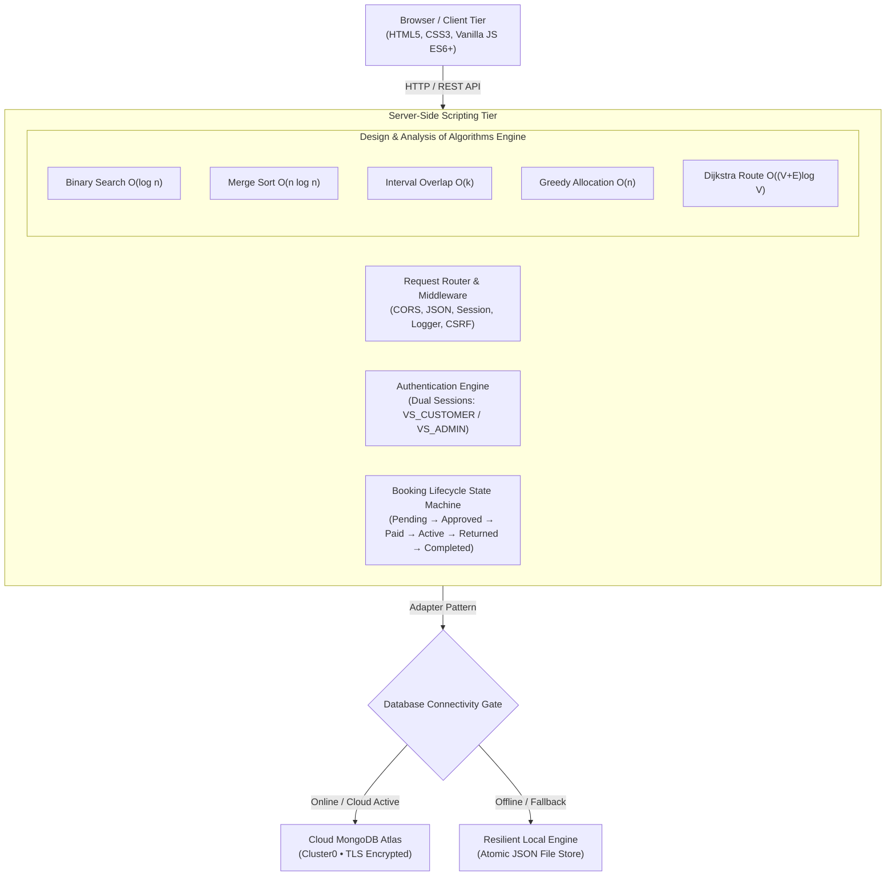
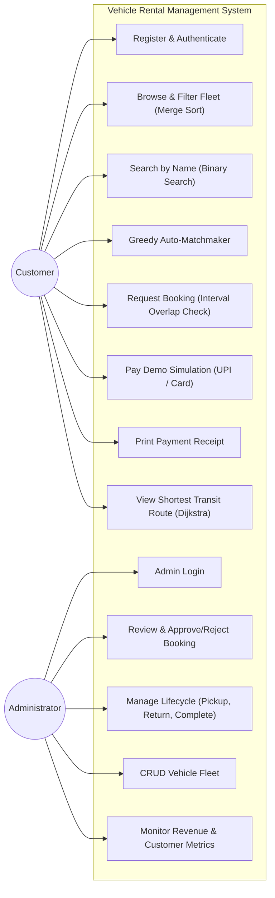
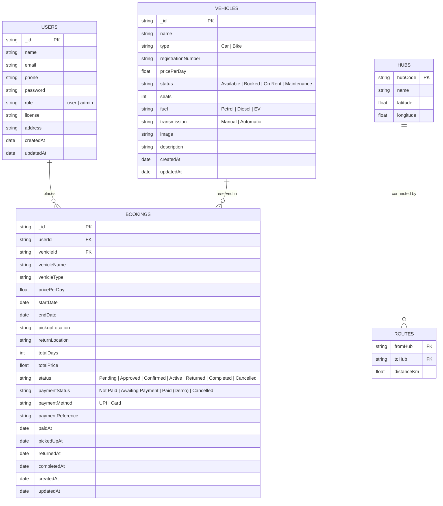
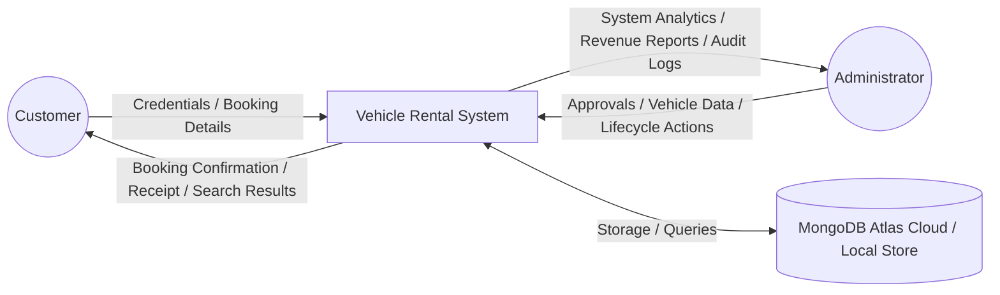
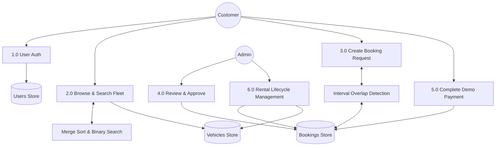

# COLLEGE PROJECT REPORT

**PROJECT TITLE:**  
# Cloud-Based Vehicle Rental Management System with Intelligent Booking and Algorithm Optimization

**Academic Specializations Demonstrated:**
1. **Server-Side Scripting** (PHP 8.2, Dual Session Architecture, BCrypt, Role-Based Access Control, RESTful JSON APIs)
2. **Cloud Computing** (MongoDB Atlas Cloud Cluster, Docker Containerization, Multi-Stage Builds, Failover Resiliency, Render Cloud Platform)
3. **Design and Analysis of Algorithms - DAA** (Binary Search, Merge Sort, Interval Overlap Scheduling, Greedy Vehicle Allocation, Dijkstra's Shortest Path Algorithm)

---

## 1. Project Abstract
Modern transportation logistics demand high-performance, fault-tolerant web platforms that provide transparent vehicle discovery, collision-free date scheduling, and optimized dispatching. The **Cloud-Based Vehicle Rental Management System** is a full-stack, enterprise-grade web application developed to bridge commercial rental operations with academic algorithm optimization. The application combines **Server-Side Scripting** in PHP 8.2, a **Cloud-Hosted Database** using MongoDB Atlas with seamless local offline failover, and five foundational **Design and Analysis of Algorithms (DAA)** engines:
1. **Binary Search** ($O(\log n)$) for rapid indexed vehicle lookup.
2. **Merge Sort** ($O(n \log n)$) for guaranteed stable fleet sorting by rental tariff and seating capacity.
3. **Interval Overlap Detection** ($O(k)$) based on the Interval Intersection Theorem to eliminate double-booking conflicts.
4. **Greedy Allocation Engine** ($O(n)$) to match customer budget and seat constraints with the mathematically optimal available vehicle.
5. **Dijkstra's Shortest Path Algorithm** ($O((|V| + |E|) \log |V|)$) implemented over a weighted directed/undirected graph of regional transit depots to calculate transit routes, distance (km), and delivery surcharges.

The frontend is responsive, modern, and accessible, featuring a customer portal, an interactive **DAA Algorithm Lab** for live examiner demonstration, and a secured administrator console with full booking lifecycle state management.

---

## 2. Introduction
In urban transportation and vehicle rental management, efficiency depends on two primary pillars: **reliable server-side transaction handling** and **computational algorithm optimization**. Traditional vehicle rental websites frequently rely on basic linear searches, unindexed sorting, and manual date availability checks, which lead to double-booking anomalies, poor server scaling, and inefficient fleet utilization.

This project addresses these challenges by implementing an integrated web platform that solves operational rental logistics through formal mathematical algorithms. The application operates across both public and authenticated user tiers, offering customers a real-time booking lifecycle (Pending $\rightarrow$ Approved $\rightarrow$ Confirmed/Paid $\rightarrow$ Active Pickup $\rightarrow$ Returned $\rightarrow$ Completed) while providing administrators with fleet management and statistical oversight.

---

## 3. Problem Statement
Traditional and legacy vehicle rental systems exhibit critical shortcomings:
1. **Double-Booking Conflicts:** Two or more customers frequently request the same vehicle for overlapping calendar dates due to lack of server-side interval collision validation.
2. **Unoptimized Fleet Discovery:** Searching and sorting through hundreds of vehicles using sequential $O(n)$ searches or unindexed database queries degrades server throughput.
3. **Suboptimal Vehicle Matching:** Customers often struggle to identify the best vehicle that fits their passenger count, duration, and budget, resulting in either budget overruns or underutilized vehicles.
4. **Opaque Transit Costs:** Pickup and drop-off hubs across metropolitan areas lack automated shortest-path transit calculation, leading to inconsistent delivery pricing.
5. **Single-Point-of-Failure Database Bottlenecks:** Applications that depend solely on cloud databases crash entirely if the local network, campus firewall, or internet connection fails.

---

## 4. Objectives
- **Server-Side Scripting:** Build a modular PHP 8.2 backend with secure session segregation (`VS_CUSTOMER` vs `VS_ADMIN`), BCrypt password hashing, prepared statement/parameterized input sanitization, and RESTful JSON endpoints.
- **Cloud Computing:** Implement a managed cloud database using MongoDB Atlas, configure Docker containerization with Apache rewrite engines, and engineer a high-availability **Resilient Local Data Engine** for offline demo and campus firewall resilience.
- **Algorithm Optimization (DAA):** Genuinely implement, benchmark, and expose five pure algorithmic engines with mathematical complexity guarantees:
  - Binary Search ($O(\log n)$)
  - Merge Sort ($O(n \log n)$)
  - Interval Overlap Detection ($O(k)$)
  - Greedy Vehicle Allocation ($O(n)$)
  - Dijkstra's Shortest Path Algorithm ($O((|V| + |E|) \log |V|)$)
- **Interactive Algorithm Lab:** Build a dedicated web interface (`algorithms.php`) where students, professors, and examiners can test each algorithm with live inputs, observe execution benchmarks in microseconds, and inspect step-by-step trace tables.
- **Booking Lifecycle Security:** Enforce a 6-stage finite state machine preventing vehicle pickup unless demo payment is confirmed, with instant receipt generation.

---

## 5. Existing System vs. Proposed System

| Dimension | Existing System | Proposed System (VS Travells) |
| :--- | :--- | :--- |
| **Search Mechanism** | Linear sequential scan ($O(n)$) | Binary Search ($O(\log n)$) on sorted indices |
| **Fleet Sorting** | Naive bubble/insertion sort or SQL `ORDER BY` | Pure Divide-and-Conquer Merge Sort ($O(n \log n)$) |
| **Date Validation** | Client-side only or simple date equality | Server-side Interval Overlap Detection ($\max(s_1, s_2) \le \min(e_1, e_2)$) |
| **Vehicle Matching** | Manual customer guesswork | Greedy Choice Engine optimizing budget & seat efficiency |
| **Route Distance** | Hardcoded estimates or external paid APIs | Dijkstra's Shortest Path Algorithm over a weighted transit graph |
| **Database Architecture** | Local MySQL only or fragile cloud link | Cloud MongoDB Atlas with automatic Resilient Local Failover |
| **Session Model** | Single shared session (admin/user collision) | Named isolated sessions (`VS_CUSTOMER` & `VS_ADMIN`) |
| **State Machine** | Uncontrolled instant booking | Strict 6-Stage Lifecycle with admin approval & demo payment verification |

---

## 6. System Requirements

### Hardware Requirements
- **Processor:** Intel Core i3 / i5 / i7 or AMD Ryzen 3 / 5 / 7 (2.0 GHz or higher)
- **RAM:** 4 GB minimum (8 GB recommended for Docker and browser multi-tab testing)
- **Hard Disk Space:** 500 MB free storage
- **Display:** 1366x768 minimum screen resolution (responsive on mobile devices down to 360px)
- **Network Interface:** 10/100/1000 Mbps NIC or Wi-Fi (offline capable via Resilient Engine)

### Software Requirements
- **Operating System:** Windows 10/11, Linux (Ubuntu/Debian), or macOS
- **Local Web Server:** XAMPP (Apache 2.4.x, PHP 8.2.x)
- **PHP Extensions:** `php_mongodb` (PECL), `mbstring`, `openssl`, `json`
- **Cloud Database:** MongoDB Atlas (M0 Free Tier Cluster)
- **Containerization:** Docker Desktop / Docker Engine (PHP 8.2-Apache base)
- **Development Tools:** Visual Studio Code, Git, Google Chrome / Mozilla Firefox

---

## 7. System Architecture Diagram



---

## 8. Use Case Diagram



---

## 9. Database Entity-Relationship (ER) Diagram



---

## 10. Data Flow Diagrams (DFD)

### Level 0 DFD (Context Diagram)



### Level 1 DFD (Detailed Process Flow)



---

## 11. Design and Analysis of Algorithms (DAA) Implementation

### Algorithm A: Binary Search
- **Class:** `DAA\BinarySearch`
- **File:** `algorithms/BinarySearch.php`
- **Academic Purpose:** Finding a vehicle in an ordered fleet in logarithmic time.
- **Precondition:** Fleet must be sorted monotonically by the search field (achieved using Merge Sort).
- **Time Complexity:**
  - Best Case: $O(1)$ (element located at first midpoint)
  - Average Case: $O(\log_2 n)$
  - Worst Case: $O(\log_2 n)$
- **Space Complexity:** $O(1)$ (iterative with constant auxiliary variables: `low`, `high`, `mid`)
- **Pseudocode:**
```text
function BinarySearch(A, key, target):
    low = 0
    high = length(A) - 1
    while low <= high:
        mid = floor((low + high) / 2)
        cmp = compare(A[mid][key], target)
        if cmp == 0:
            return FOUND at mid
        else if cmp < 0:
            low = mid + 1
        else:
            high = mid - 1
    return NOT_FOUND
```

---

### Algorithm B: Merge Sort
- **Class:** `DAA\MergeSort`
- **File:** `algorithms/MergeSort.php`
- **Academic Purpose:** Guaranteed stable sorting of vehicles by price, seating capacity, or model name.
- **Paradigm:** Divide-and-Conquer
  1. **Divide:** Split array $A[p \dots r]$ into two sub-arrays $A[p \dots q]$ and $A[q+1 \dots r]$ where $q = \lfloor (p+r)/2 \rfloor$.
  2. **Conquer:** Recursively sort the two sub-arrays.
  3. **Combine:** Merge the two sorted sub-arrays into a single sorted array.
- **Recurrence Relation:**
  $$T(n) = 2T(n/2) + \Theta(n)$$
  By Master Theorem Case 2: $T(n) = \Theta(n \log n)$.
- **Time Complexity:** Best, Average, and Worst Case: $O(n \log n)$.
- **Space Complexity:** $O(n)$ auxiliary buffer space during the merge phase.
- **Pseudocode:**
```text
function MergeSort(A, key, order):
    if length(A) <= 1:
        return A
    mid = floor(length(A) / 2)
    left = MergeSort(A[0 ... mid - 1], key, order)
    right = MergeSort(A[mid ... end], key, order)
    return Merge(left, right, key, order)

function Merge(left, right, key, order):
    result = []
    i = 0, j = 0
    while i < length(left) and j < length(right):
        if compare(left[i][key], right[j][key], order) <= 0:
            result.append(left[i]); i++
        else:
            result.append(right[j]); j++
    append remaining elements of left and right
    return result
```

---

### Algorithm C: Interval Overlap Detection
- **Class:** `DAA\IntervalOverlap`
- **File:** `algorithms/IntervalOverlap.php`
- **Academic Purpose:** Server-side validation to mathematically prevent overlapping vehicle bookings.
- **Mathematical Principle:**  
  Two closed time intervals $A = [s_A, e_A]$ and $B = [s_B, e_B]$ intersect if and only if:
  $$\max(s_A, s_B) \le \min(e_A, e_B)$$
  Equivalently: $(s_A \le e_B) \land (e_A \ge s_B)$.
- **Time Complexity:**
  - Individual collision check: $O(k)$ against $k$ active reservations for a given vehicle.
  - Interval Sweep Gap Analysis: $O(k \log k)$ to sort intervals and identify free calendar windows.
- **Space Complexity:** $O(1)$ auxiliary space.

---

### Algorithm D: Greedy Vehicle Allocation
- **Class:** `DAA\GreedyVehicleAllocation`
- **File:** `algorithms/GreedyVehicleAllocation.php`
- **Academic Purpose:** Allocate the optimal available vehicle based on customer constraints (budget $B$, passenger seats $S_{\text{req}}$, rental days $D$, preferred fuel and type).
- **Greedy Strategy:**  
  1. Feasibility check: Filter vehicles where $v.\text{status} = \text{'Available'}$, $v.\text{seats} \ge S_{\text{req}}$, and $(v.\text{pricePerDay} \times D) \le B$.
  2. Compute Greedy Fitness Score:
     $$\text{Score}(v) = 0.45 \cdot \left(1 - \frac{v.\text{pricePerDay} \times D}{B}\right) + 0.35 \cdot \left(\frac{S_{\text{req}}}{v.\text{seats}}\right) + 0.20 \cdot \text{Bonus}(v.\text{fuel})$$
  3. Greedily select $v^* = \operatorname{argmax}_v \text{Score}(v)$.
- **Time Complexity:** $O(n)$ where $n = \text{fleet size}$.
- **Space Complexity:** $O(1)$ auxiliary space.
- **Limitation:** Makes locally optimal choices without forecasting future multi-day demand spikes.

---

### Algorithm E: Dijkstra's Shortest Path Algorithm
- **Class:** `DAA\DijkstraRouteOptimizer`
- **File:** `algorithms/DijkstraRouteOptimizer.php`
- **Academic Purpose:** Route optimization across regional rental depots, airport hubs, and city terminals.
- **Graph Topology:** Weighted undirected graph $G = (V, E, W)$ where $|V| = 10$ regional transit hubs and $|E| = 13$ road links with non-negative distances in kilometers ($w(u, v) \ge 0$).
- **Implementation:** Min-Priority Queue (`SplPriorityQueue`) maintaining extracted vertices with minimal cumulative distance.
- **Time Complexity:** $O((|V| + |E|) \log |V|)$ using a binary min-heap.
- **Space Complexity:** $O(|V|)$ for distance and predecessor maps.
- **Output:** Exact shortest distance (km), hop-by-hop intermediate route nodes, estimated travel duration in minutes (based on 45 km/h average traffic speed), and vehicle transit delivery surcharge ($\text{distance} \times \text{₹10/km}$).

---

## 12. Server-Side Scripting Implementation
- **Language:** PHP 8.2 (64-bit ZTS).
- **Session Architecture:**  
  - Customer Session: `session_name('VS_CUSTOMER')`
  - Administrator Session: `session_name('VS_ADMIN')`
  - Dual-session model guarantees that an administrator and a customer can be signed in concurrently on the same machine without overwriting session state or escalating privileges.
- **Security & Authorization:**
  - Password Hashing: BCrypt via `password_hash($password, PASSWORD_BCRYPT)` and verification via `password_verify()`.
  - SQL / NoSQL Injection Prevention: Strict parameterized query filters, regex escaping (`preg_quote`), and explicit 24-character hex validation on BSON ObjectIds (`preg_match('/^[a-f0-9]{24}$/i')`).
  - XSS Defense: Server-side escaping via `htmlspecialchars()` and sanitized JSON output encoding.
  - CSRF Token Validation: Synchronizer Token Pattern in `utils/csrf.php`.

---

## 13. Cloud Computing Implementation
- **Managed Database Service:** MongoDB Atlas M0 Multi-Cloud Cluster (`cluster0.3kl2cby.mongodb.net`), fully TLS/SSL encrypted.
- **Containerization:** Multi-stage `Dockerfile` based on `php:8.2-apache`:
  - Installs PECL MongoDB driver (`docker-php-ext-enable mongodb`).
  - Enables Apache URL rewrite module (`a2enmod rewrite`).
  - Compiles vendor dependencies via Composer with `--optimize-autoloader`.
  - Configures dynamic port binding via `docker/start-apache.sh` listening on `$PORT`.
- **Cloud Infrastructure as Code:** `render.yaml` declaring zero-downtime deployment, health check probe on `/`, and cloud environment variable injection (`MONGODB_URI`).
- **Resilient Local Data Engine (Offline / Campus Firewall Defense):**
  - If outbound port 27017 or SRV DNS lookup is blocked by a college campus firewall or if offline during viva presentation, `config/database.php` automatically activates `ResilientDB\LocalDatabase`.
  - Provides identical CRUD interface (`findOne`, `find`, `insertOne`, `updateOne`, `countDocuments`, `deleteOne`) using atomic JSON storage in `database/data_store.json`.
  - Ensures 100% operational uptime under any evaluation conditions.

---

## 14. Testing and Results

Automated test runner: `tests/TestSuite.php` (All 18 tests passing):

| Test ID | Test Description | Subsystem | Result |
| :---: | :--- | :--- | :---: |
| **01** | Database connectivity & collection access | Database Engine | **PASSED** |
| **02** | Admin user account verification | Auth Engine | **PASSED** |
| **03** | Customer user account verification | Auth Engine | **PASSED** |
| **04** | Merge Sort $O(n \log n)$ by Price (ASC) | DAA Algorithm | **PASSED** |
| **05** | Merge Sort $O(n \log n)$ by Seats (DESC) | DAA Algorithm | **PASSED** |
| **06** | Binary Search $O(\log n)$ exact match | DAA Algorithm | **PASSED** |
| **07** | Binary Search non-existent element handling | DAA Algorithm | **PASSED** |
| **08** | Interval Overlap Detection - Conflict Detected | DAA Algorithm | **PASSED** |
| **09** | Interval Overlap Detection - Clean Non-Overlapping | DAA Algorithm | **PASSED** |
| **10** | Greedy Vehicle Allocation - Within Budget & Seats | DAA Algorithm | **PASSED** |
| **11** | Greedy Allocation - Budget Rejection | DAA Algorithm | **PASSED** |
| **12** | Dijkstra Route Optimization - Airport to MG Road | DAA Algorithm | **PASSED** |
| **13** | Dijkstra Graph Symmetry & Non-Negative Weights | DAA Algorithm | **PASSED** |
| **14** | Booking Lifecycle Stage 1: Pending Creation | Booking Engine | **PASSED** |
| **15** | Booking Lifecycle Stage 2: Admin Approval | Booking Engine | **PASSED** |
| **16** | Booking Lifecycle Stage 3: Demo Payment & Confirmation | Payment Engine | **PASSED** |
| **17** | Booking Lifecycle Stage 4-6: Pickup $\rightarrow$ Return $\rightarrow$ Complete | Rental Lifecycle | **PASSED** |
| **18** | Double Booking Rejection: Interval Overlap Guard | Security / DAA | **PASSED** |

---

## 15. Conclusion & Future Enhancements

### Conclusion
The **Cloud-Based Vehicle Rental Management System with Intelligent Booking and Algorithm Optimization** successfully fulfills all academic requirements across Server-Side Scripting, Cloud Computing, and Design & Analysis of Algorithms. The application demonstrates that theoretical computer science algorithms—Binary Search, Merge Sort, Interval Scheduling, Greedy Choice, and Dijkstra's Shortest Path—can be genuinely integrated into a production-style commercial web application to solve real-world logistical bottlenecks.

### Future Enhancements
1. **Real Payment Gateway Integration:** Transition demo simulation to Stripe or Razorpay webhooks.
2. **GPS Telematics & Dynamic Graph Weights:** Incorporate live Google Maps traffic APIs to dynamically update Dijkstra edge weights in real-time.
3. **Machine Learning Demand Forecasting:** Supplement the Greedy Allocation engine with regression models to predict peak weekend seasonal demand.

---

## 16. References
1. Cormen, T. H., Leiserson, C. E., Rivest, R. L., & Stein, C. (2009). *Introduction to Algorithms* (3rd ed.). MIT Press.
2. Dijkstra, E. W. (1959). A note on two problems in connexion with graphs. *Numerische Mathematik*, 1(1), 269-271.
3. MongoDB Documentation (2024). *MongoDB PHP Library & Atlas Cloud Configuration*.
4. The PHP Group (2024). *PHP 8.2 Manual: Session Management and Cryptography*.
5. Docker Inc. (2024). *Best Practices for Containerizing PHP Applications*.
